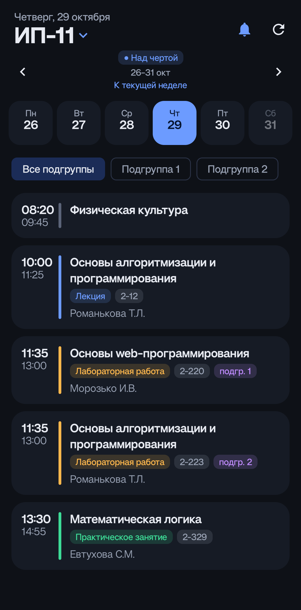

# Пары ГГТУ

Android-приложение с расписанием занятий для студентов ГГТУ им. П. О. Сухого (Гомель).

> Неофициальное приложение: оно не связано с университетом и берёт данные с открытого сайта расписания [sc.gstu.by](https://sc.gstu.by).

## Что умеет

- Выбор группы поиском и подгруппы, выбор запоминается.
- Расписание по дням: время, предмет, тип занятия, аудитория, преподаватель. Дни листаются свайпом.
- Учёт недель «над чертой» и «под чертой», настоящее время пар, подсветка идущей пары.
- «Окна» между парами.
- Два виджета на главный экран: 4×3 (день целиком) и 4×2 (ближайшие пары).
- Работа без интернета: расписание сохраняется на телефоне.
- Напоминание перед первой парой или перед каждой и сообщение, если расписание изменилось (по желанию).
- Обновление прямо из приложения: оно само скажет, когда вышла новая версия.

## Скриншоты

<p>
  
  
  
</p>

## Скачать и установить

1. Откройте страницу [Releases](../../releases/latest) и скачайте файл `Pary-GGTU-*.apk` (нужен Android 7.0 или новее).
2. Нажмите на скачанный файл. Телефон попросит разрешить установку из этого источника: разрешите.
3. Если появится предупреждение Play Protect, нажмите «Подробнее» → «Всё равно установить»: приложение не из Google Play.
4. Откройте «Пары ГГТУ» и выберите свою группу.

Начиная с версии 1.2 приложение само проверяет, не вышла ли новая версия, и предлагает обновиться: оно скачает файл с GitHub, проверит контрольную сумму и подпись и попросит подтвердить установку. Один раз Android спросит разрешение «Установка неизвестных приложений» для «Пары ГГТУ». Версию 1.0 и 1.1 нужно обновить вручную по ссылке выше.

Приложение ничего не собирает: оно только запрашивает расписание у сайта университета.

## Сборка из исходников

Нужны Android Studio и JDK 17+ (подойдёт JDK из Android Studio).

```bash
./gradlew assembleDebug      # отладочная сборка
./gradlew testDebugUnitTest  # тесты
```

Для подписанной release-сборки создайте `keystore.properties` рядом с `build.gradle.kts` (в репозиторий он не попадает):

```properties
storeFile=путь/к/ключу.jks
storePassword=...
keyAlias=...
keyPassword=...
```

После этого: `./gradlew assembleRelease`.

## Как это устроено

Kotlin, Jetpack Compose, Jetpack Glance (виджеты), DataStore. Подробности и заметки по проекту: [CLAUDE.md](CLAUDE.md).

Расписание приходит из недокументированного API сайта университета, поэтому оно может измениться без предупреждения.
